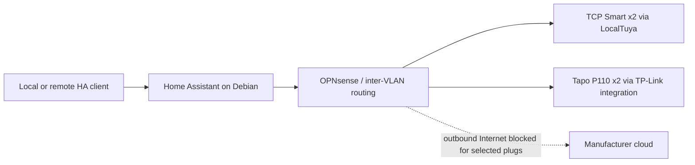

# Local smart plug control with Home Assistant

I started with two older **TCP Smart Wi-Fi plugs** that I wanted to control through Home Assistant without resetting or re-pairing them. Getting there took network troubleshooting, Android emulator analysis and Python to recover the information needed for encrypted local control.

Later I added **two TP-Link Tapo P110 plugs**. Those were far more straightforward: I used the official Tapo app to set them up, enabled third-party compatibility and added them through Home Assistant's built-in TP-Link integration.

By **21 November 2026**, all four plugs were working through Home Assistant while their manufacturers' apps showed them **offline**. A reusable OPNsense rule now blocks their outbound IPv4 Internet connections. I tested Home Assistant control both from my home network and while accessing Home Assistant over 4G/5G.

This repository is the record of what worked, what didn't and how I verified the result. It is **not** a universal plug-unlocking tool or an export of my live home network.

## Where to start

| Guide | What you'll find |
| --- | --- |
| **[TCP Smart investigation](docs/tcp-case-study.md)** | The original local-key recovery story, dead ends, safe example scripts and Home Assistant LocalTuya setup |
| **[Tapo P110 setup](docs/tapo-p110.md)** | A browser-led integration using the official TP-Link Smart Home integration, with initial provisioning in the mobile app |
| **[OPNsense local-only policy](docs/local-only-firewall.md)** | A reusable firewall alias, safe rule ordering, state clearing, cloud-disconnection tests and rollback |
| [Evidence and remaining work](docs/validation.md) | Which TCP tests passed, and which related behaviours remain untested |
| [Security and redaction](docs/security.md) | What I deliberately kept out of the public repository |

## The two integration paths

| | Older TCP Smart plugs | Tapo P110 plugs |
| --- | --- | --- |
| Quantity tested | 2 | 2 |
| Home Assistant integration | **LocalTuya** (custom) | **TP-Link Smart Home** (built-in) |
| Initial challenge | Encrypted LAN commands required device-specific local keys | Enable third-party compatibility, add each plug by its reserved IP |
| Local-key extraction | Needed for this particular setup | **Not needed** for this setup |
| HA switching after cloud disconnection | **Verified** | **Verified** |
| Sensor data | Relay state; a local countdown datapoint on one TCP plug | Current, voltage, power, daily/monthly energy entities |
| Manufacturer app during final test | Reported both offline | Reported both offline |

The **TCP Smart local-key recovery** used an isolated, user-controlled Android emulator. Four sanitised historical scripts are retained under [`scripts/original-sanitised/`](scripts/original-sanitised/); [`examples/local_switch_check.py`](examples/local_switch_check.py) and [`examples/monitor_dps.py`](examples/monitor_dps.py) are separate, sanitised examples. None contains working device keys or private accounts.

## How the final setup fits together

Home Assistant runs as a container on a Debian host, separately routed from a dedicated IoT VLAN. The firewall permits Home Assistant to initiate connections to the plugs but blocks new Internet connections initiated by selected IoT devices.

The diagram shows the **observed Home Assistant control path**, not a claim about every packet or transport used by the device firmware. Remote phone access reaches **Home Assistant**, not the manufacturer cloud.

I created the OPNsense host alias **`IOT_LOCAL_ONLY`**, grouped the four plugs' **DHCP-reserved IP addresses**, and used a single IPv4 block rule:

> **Block Internet - Local-Only IoT Devices**

The IoT interface was configured with IPv6 set to **None**. An existing higher-priority rule continued to allow queries to a local Pi-hole DNS server. For exact steps and caveats, see the [firewall guide](docs/local-only-firewall.md).

## What I actually tested

1. **TCP Smart:** recovered and matched per-device keys on my own paired equipment, proved direct LAN switching, then added both devices to LocalTuya without configuring a Tuya Cloud API account.
2. **Tapo P110:** added both manually through Home Assistant, confirmed switching and the available power/energy sensor entities. A supervised load test on **one** P110 produced plausible power readings of approximately **700 W, 1,000 W and 1,700 W** at three radiator settings. This was not a calibration of accumulated kWh.
3. **Network isolation:** applied the OPNsense Internet block, cleared the plugs' old firewall states where necessary and observed vendor apps show all four devices offline.
4. **Home Assistant after isolation:** switching remained functional for **all four plugs**, and the Tapo sensors continued reporting. I also tested HA control over the home LAN and by connecting to HA over **4G/5G**.
5. **Still open:** long-term restart/offline resilience, measured response times, cumulative energy accuracy, cloud-free execution of the TCP countdown and any weekly schedule, and Home Assistant energy-history dashboards.

This confirms that **Home Assistant control did not require an active vendor-cloud connection in the tested configuration**. It does not establish zero external information exchange under every possible configuration.

## Security and limitations

- This project documents equipment I own and am authorised to test.
- No real IP addresses, MAC addresses, cloud credentials, Tuya local keys, device IDs, Wi-Fi names, live firewall exports or emulator memory dumps are published.
- New devices and firmware versions may differ. Add a new model to a cloud-blocking rule only after verifying its local integration.
- A vendor app reporting a plug offline is expected when its cloud access is restricted. Firmware upgrades and cloud-only features may require temporary Internet access.
- Smart plugs switching heaters and other high-load equipment require appliance-specific safety precautions; use a small non-heating test load when demonstrating switching.

See the [changelog](CHANGELOG.md) for the original October investigation and the November extension to two manufacturers.

**Project dates:** TCP investigation and Home Assistant integration in October 2026; Tapo P110 integration and verified cloud-independent operation of all four plugs on **21 November 2026**.
